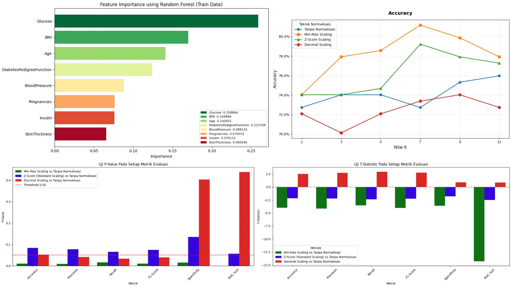
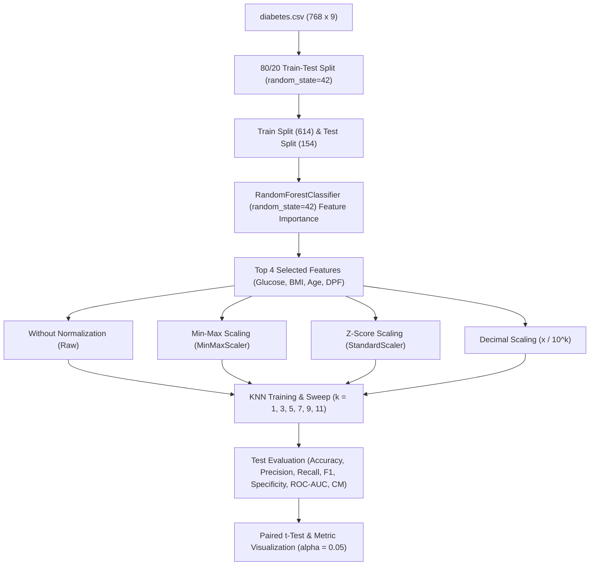
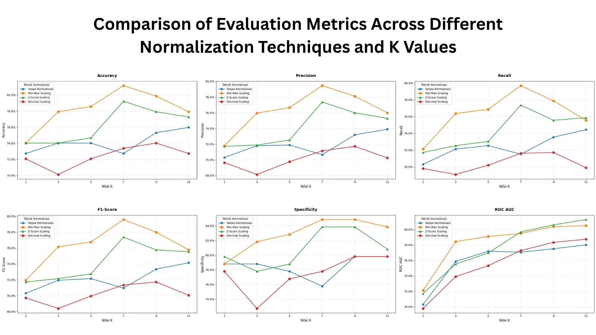
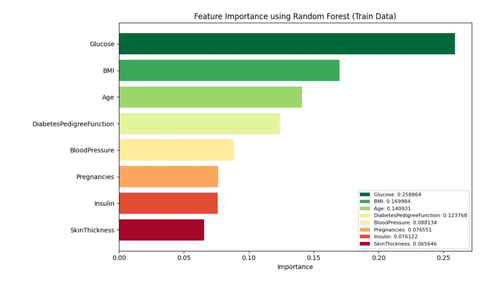
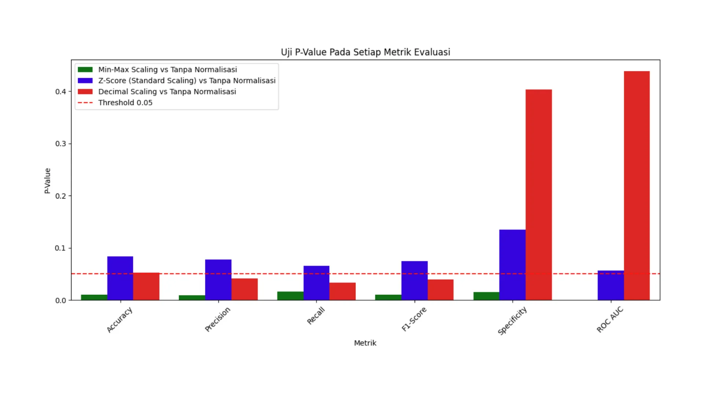
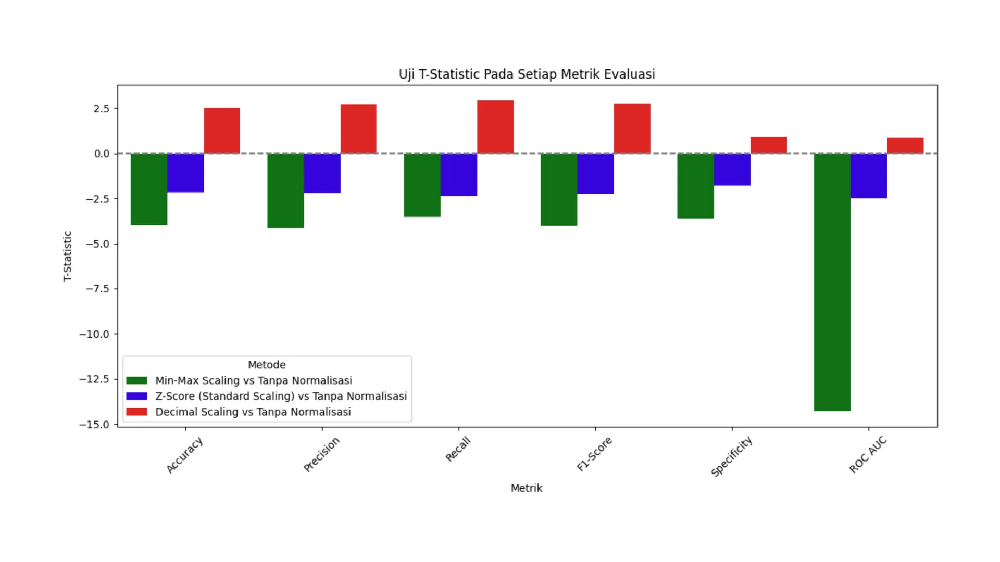

# Diabetes Classification Using KNN with Data Normalization




## Project Overview

This repository presents an empirical Machine Learning study evaluating how data normalization techniques affect the classification performance of the K-Nearest Neighbors (KNN) algorithm on clinical diabetes records. Because KNN relies on distance calculations in feature space, unscaled clinical measurements with heterogeneous units and numerical ranges can distort neighborhood similarity. The project benchmarks unscaled baseline features against Min-Max Scaling, Z-Score Standardization, and Decimal Scaling across six neighborhood sizes and validates performance differences with paired statistical hypothesis testing.

## Problem Statement & Objectives

Distance-based classifiers such as K-Nearest Neighbors are sensitive to feature magnitude discrepancies: features with large numerical spans dominate Euclidean distance computations over clinically relevant features measured on smaller scales. Without appropriate preprocessing and feature selection, neighborhood voting can misclassify diabetic and non-diabetic cases.

- Construct a leak-free, reproducible tabular classification pipeline using an 80/20 train-test split (`614` training rows and `154` testing rows) on `diabetes.csv`.
- Identify the most informative clinical predictors via Random Forest feature importance computed strictly on the training split.
- Compare KNN classification performance across four scaling regimes—Without Normalization, Min-Max Scaling, Z-Score (Standard Scaling), and Decimal Scaling—over `k` values `[1, 3, 5, 7, 9, 11]`.
- Evaluate all configurations using Accuracy, macro-averaged Precision, Recall, F1-Score, Specificity, ROC-AUC, and Confusion Matrices.
- Quantify whether performance improvements over the unscaled baseline are statistically significant (`p < 0.05`) using paired t-tests across all tested `k` values.

## Data & Input Sources

The project uses the local tabular clinical dataset [diabetes.csv](diabetes.csv), containing 768 patient records with 8 numerical diagnostic measurements and 1 binary target (`Outcome`). Inspection confirms zero missing (`null`) entries and zero duplicate rows (`df.duplicated().sum() == 0`), though some clinical measurements contain zero values as recorded in the source dataset.

| Attribute | Description |
| :--- | :--- |
| Dataset / Input Source | Pima Indians Diabetes Tabular Dataset |
| Source | [diabetes.csv](diabetes.csv) |
| Format | CSV (`int64` and `float64` tabular columns) |
| Samples / Records | 768 total (`614` train / `154` test via 80/20 split) |
| Features / Input Shape | 8 raw clinical features (`Glucose`, `BMI`, `Age`, `DiabetesPedigreeFunction`, `BloodPressure`, `Pregnancies`, `Insulin`, `SkinThickness`); top 4 selected |
| Target / Label | `Outcome` (`0`: Non-Diabetic [500 samples, 65.10%], `1`: Diabetic [268 samples, 34.90%]; Test split: 99 negative, 55 positive) |

## Data Preprocessing & Feature Engineering

To prevent data leakage and isolate the effect of feature scaling, dataset splitting precedes feature selection and normalization across all four experimental notebooks. Random Forest feature importance (`RandomForestClassifier(random_state=42)`) is fit solely on the 614-row training set, retaining the top four predictors (`Glucose`, `BMI`, `Age`, `DiabetesPedigreeFunction`) and dropping the lower-ranked features (`BloodPressure`, `Pregnancies`, `Insulin`, `SkinThickness`).

| Transformation | Input | Output | Scope |
| :--- | :--- | :--- | :--- |
| Train-Test Split (`test_size=0.2`, `random_state=42`) | `diabetes.csv` (`768 x 9`) | `diabetes_train.csv` (`614 x 9`), `diabetes_test.csv` (`154 x 9`) | All 4 experiments |
| Random Forest Feature Selection | 8 numerical features (`train_df`) | Top 4 features (`diabetes_train_selected.csv`, `diabetes_test_selected.csv`) | All 4 experiments |
| Min-Max Scaling (`MinMaxScaler`) | Selected 4 features | Scaled `[0, 1]` CSVs (`Min-Max Scaling/diabetes_*_scaled.csv`) | Experiment 2 (Min-Max) |
| Z-Score Standardization (`StandardScaler`) | Selected 4 features | Zero-mean, unit-variance CSVs (`Z-Score (Standard Scaling)/diabetes_*_scaled.csv`) | Experiment 2 (Z-Score) |
| Decimal Scaling (`x / 10^k`, $k = \lceil \log_{10}(\max(x)) \rceil$) | Selected 4 features | Decimal-scaled CSVs (`Decimal Scaling/diabetes_*_scaled.csv`) | Experiment 2 (Decimal) |

1. Split `diabetes.csv` into `614` training and `154` testing records (`random_state=42`).
2. Fit `RandomForestClassifier(random_state=42)` on the training split to rank all 8 clinical features by Gini importance.
3. Retain the top 4 features (`Glucose`: `0.258864`, `BMI`: `0.169984`, `Age`: `0.140931`, `DiabetesPedigreeFunction`: `0.123768`) and export selected train/test CSVs.
4. Apply the respective scaling method (`MinMaxScaler`, `StandardScaler`, or custom `decimal_scaling`, or leave raw for baseline) and export scaled CSV datasets.

## Tech Stack

| Category | Technology | Purpose |
| :--- | :--- | :--- |
| Programming Language | Python | Core implementation across experiment and visualization notebooks |
| Machine Learning | Scikit-Learn | `train_test_split`, `RandomForestClassifier`, `KNeighborsClassifier`, `MinMaxScaler`, `StandardScaler`, and classification metrics |
| Data Manipulation | Pandas | CSV ingestion, DataFrame inspection, feature dropping, and scaled dataset export |
| Numerical Computing | NumPy | Array operations and base-10 logarithmic computation for Decimal Scaling |
| Statistical Testing | SciPy | Paired sample t-tests (`scipy.stats.ttest_rel`) across normalization regimes |
| Data Visualization | Matplotlib | Line plots, bar charts, ROC curves, and multi-metric comparison plots |
| Statistical Plotting | Seaborn | Confusion matrix heatmaps and grouped statistical bar charts |
| Interactive Environment | Jupyter Notebook | Reproducible `.ipynb` experiment execution and inline cell output capture |

## Machine Learning Approach

The project adopts a supervised binary classification approach tailored to tabular clinical diagnostics. Because KNN classifies samples based on nearest-neighbor distance in feature space, pairing dimensionality reduction (selecting the top four predictors) with controlled normalization comparisons isolates how each scaling geometry affects neighborhood boundaries.

| Attribute | Value |
| :--- | :--- |
| Learning Paradigm | Supervised Learning |
| Problem Domain | Healthcare / Clinical Tabular Diagnostics |
| ML Task | Binary Classification (`Outcome`: `0` vs. `1`) |
| Primary Classifier | K-Nearest Neighbors (`KNeighborsClassifier`) |
| Feature Selector | Random Forest (`RandomForestClassifier`) Gini Importance |
| Experimental Design | 4 scaling regimes x 6 neighborhood sizes (`k` in `{1, 3, 5, 7, 9, 11}`) |

## Model Overview

The primary predictive model is Scikit-Learn's `KNeighborsClassifier`, evaluated across six odd neighborhood counts (`k = 1, 3, 5, 7, 9, 11`) to avoid tie votes in binary classification. An auxiliary `RandomForestClassifier` is used strictly during preprocessing on the training split to select the four most predictive features. No external pretrained weights are loaded; all models are fit directly on the project's training split.

| Attribute | Details |
| :--- | :--- |
| Model Name | K-Nearest Neighbors Classifier |
| Algorithm / Family | Instance-based non-parametric supervised classifier |
| Framework | Scikit-Learn (`sklearn.neighbors.KNeighborsClassifier`) |
| Input Space | 4 selected clinical features (`Glucose`, `BMI`, `Age`, `DiabetesPedigreeFunction`) |
| Output Space | Binary class prediction (`0` or `1`) and positive-class probability (`predict_proba`) |
| Pretrained Status | Not pretrained; trained directly on `614` local training records per experiment |

## ML Workflow

The experimental pipeline progresses across four dedicated scaling notebooks followed by three cross-experiment comparison and statistical testing notebooks:

1. **Dataset Ingestion & Auditing**: Load [diabetes.csv](diabetes.csv), verify schema (`768 x 9`), confirm zero nulls/duplicates, and separate numerical features from `Outcome`.
2. **Train-Test Partitioning**: Split records 80/20 (`random_state=42`) into 614 training and 154 test samples.
3. **Training-Only Feature Selection**: Fit `RandomForestClassifier(random_state=42)` on training data and keep the top 4 features (`Glucose`, `BMI`, `Age`, `DiabetesPedigreeFunction`).
4. **Parallel Normalization Experiments**: Execute [Tanpa Normalisasi](Tanpa%20Normalisasi/Eksperimen%202%20-%20Tanpa%20Normalisasi.ipynb), [Min-Max Scaling](Min-Max%20Scaling/Eksperimen%202%20-%20Min-Max%20Scaling.ipynb), [Z-Score Scaling](Z-Score%20%28Standard%20Scaling%29/Eksperimen%202%20-%20Z-Score%20%28Standard%20Scaling%29.ipynb), and [Decimal Scaling](Decimal%20Scaling/Eksperimen%202%20-%20Decimal%20Scaling.ipynb), sweeping `k` in `[1, 3, 5, 7, 9, 11]`.
5. **Per-Model Evaluation & Plot Export**: Record classification reports, Accuracy, macro Precision/Recall/F1, Specificity, ROC-AUC, and Confusion Matrices across all 24 trained KNN configurations.
6. **Cross-Method Metric Aggregation**: Consolidate all per-`k` metric curves in [Visualisasi/Metrik_Evaluasi.ipynb](Visualisasi/Metrik_Evaluasi.ipynb).
7. **Paired Statistical Significance Testing**: Run paired t-tests (`scipy.stats.ttest_rel`) in [Visualisasi/Signifikansi Semua Nilai K.ipynb](Visualisasi/Signifikansi%20Semua%20Nilai%20K.ipynb) and plot `t`-statistics and `p`-values in [Visualisasi/Visualisasi Uji Statistik.ipynb](Visualisasi/Visualisasi%20Uji%20Statistik.ipynb).

## ML Pipeline Architecture

The diagram below illustrates the shared preprocessing backbone branching into the four normalization arms, parallel KNN `k`-sweep evaluation, and downstream paired statistical verification.



## Model Training & Configuration

Every experiment fits `KNeighborsClassifier(n_neighbors=k)` on the 614 training samples for each `k` in `[1, 3, 5, 7, 9, 11]` and stores the fitted estimators in a `knn_models` dictionary in memory. Because KNN is a lazy, instance-based learner, fitting indexes the training feature vectors without iterative gradient optimization, epochs, or learning rates; distance metric (`minkowski`, `p=2`, i.e., Euclidean) and neighbor weighting (`uniform`) follow Scikit-Learn defaults.

| Component | Configuration | Verified Value |
| :--- | :--- | :--- |
| Train / Test Split | `train_test_split` | `test_size=0.2`, `random_state=42` (`614` train / `154` test) |
| Feature Selector | `RandomForestClassifier` | `random_state=42` (top 4 of 8 features retained) |
| Classifier | `KNeighborsClassifier` | `n_neighbors` in `[1, 3, 5, 7, 9, 11]` (Scikit-Learn default Euclidean distance, uniform weights) |
| Scalers Evaluated | Preprocessing transforms | None, `MinMaxScaler`, `StandardScaler`, custom `decimal_scaling` |
| Statistical Test | `scipy.stats.ttest_rel` | Paired t-test across the 6 `k` values (`alpha = 0.05`) |

```python
from sklearn.neighbors import KNeighborsClassifier

k_values = [1, 3, 5, 7, 9, 11]
knn_models = {}
for k in k_values:
    knn = KNeighborsClassifier(n_neighbors=k)
    knn.fit(X_train_scaled, y_train_selected)
    knn_models[k] = knn
```

## Hyperparameter Tuning & Experiment Tracking

Hyperparameter exploration systematically sweeps the neighborhood parameter `k` over odd integers `[1, 3, 5, 7, 9, 11]` across each normalization method rather than using automated grid search. Experiment outputs, generated CSV splits, and PNG metric figures are persisted in method-specific directories and aggregated manually inside `Visualisasi/Metrik_Evaluasi.ipynb`.

| Scaling Method | Optimal `k` (Accuracy) | Peak Accuracy | Peak Macro F1 | Peak Specificity | Peak ROC-AUC (at `k`) |
| :--- | :---: | :---: | :---: | :---: | :---: |
| Without Normalization | `11` | `75.97%` | `74.14%` | `79.80%` | `0.7802` (`k = 11`) |
| Min-Max Scaling | `7` | **`81.17%`** | **`79.58%`** | **`84.85%`** | `0.8050` (`k = 11`) |
| Z-Score (Standard Scaling) | `7` | `79.22%` | `77.37%` | `83.84%` | **`0.8129`** (`k = 11`) |
| Decimal Scaling | `9` | `74.03%` | `71.72%` | `79.80%` | `0.7874` (`k = 11`) |

## Model Comparison & Selection

Comparing the four normalization regimes against the unscaled baseline reveals that `Min-Max Scaling` at `k = 7` delivers the highest overall classification accuracy (`81.17%`), macro F1-Score (`79.58%`), and specificity (`84.85%`). Paired two-sided t-tests (`scipy.stats.ttest_rel`) across all six `k` values confirm that only `Min-Max Scaling` produces statistically significant improvements (`p < 0.05`) across all six evaluation metrics compared to Without Normalization.

| Comparison vs. Without Normalization | Accuracy `p`-value | Precision `p`-value | Recall `p`-value | F1-Score `p`-value | Specificity `p`-value | ROC-AUC `p`-value |
| :--- | :---: | :---: | :---: | :---: | :---: | :---: |
| Min-Max Scaling | `0.01035` (Sig.) | `0.00909` (Sig.) | `0.01648` (Sig.) | `0.01011` (Sig.) | `0.01545` (Sig.) | `0.00003` (Sig.) |
| Z-Score (Standard Scaling) | `0.08363` (NS) | `0.07737` (NS) | `0.06497` (NS) | `0.07413` (NS) | `0.13454` (NS) | `0.05603` (NS) |
| Decimal Scaling | `0.05273` (NS) | `0.04112` (Sig. lower) | `0.03284` (Sig. lower) | `0.03892` (Sig. lower) | `0.40318` (NS) | `0.43839` (NS) |

## Model Evaluation & Results

All reported metrics are computed on the held-out 154-sample test split (`99` negative, `55` positive), with Precision, Recall, and F1-Score reported as macro averages across both classes. The strongest single-point classifier is `KNN (k = 7)` with `Min-Max Scaling`, improving test accuracy by `+5.20` percentage points over the best unscaled baseline (`75.97%` at `k = 11`) and `+8.44` percentage points over unscaled KNN at the same `k = 7` (`72.73%`).

| Scaling Regime (`k`) | Test Accuracy | Macro Precision | Macro Recall | Macro F1-Score | Specificity | ROC-AUC |
| :--- | :---: | :---: | :---: | :---: | :---: | :---: |
| Min-Max Scaling (`k = 7`, Best) | **`81.17%`** | **`79.46%`** | **`79.70%`** | **`79.58%`** | **`84.85%`** | `0.7950` |
| Z-Score Scaling (`k = 7`) | `79.22%` | `77.37%` | `77.37%` | `77.37%` | `83.84%` | `0.7969` |
| Z-Score Scaling (`k = 11`, Peak AUC) | `77.27%` | `75.29%` | `75.86%` | `75.54%` | `80.81%` | **`0.8129`** |
| Without Normalization (`k = 11`, Best Raw) | `75.97%` | `73.90%` | `74.44%` | `74.14%` | `79.80%` | `0.7802` |
| Decimal Scaling (`k = 9`, Best Decimal) | `74.03%` | `71.72%` | `71.72%` | `71.72%` | `79.80%` | `0.7834` |

- **Best Confusion Matrix (`Min-Max Scaling`, `k = 7`)**: `TN = 84`, `FP = 15`, `FN = 14`, `TP = 41` (Class 0 F1 = `0.8528`, Class 1 F1 = `0.7387`).
- **Statistical Significance**: Min-Max Scaling yields negative `t`-statistics (indicating higher metric means than unscaled baseline) with `p < 0.05` on every metric, peaking in consistency on ROC-AUC (`t = -14.30525`, `p = 0.00003`).
- **Observed Limitations**: In `Decimal Scaling`, `decimal_scaling()` is applied separately to `X_train_selected` and `X_test_selected` rather than reusing the training maximum exponent on the test split, and `Visualisasi/Signifikansi Semua Nilai K.ipynb` records `0.7121` for Min-Max Recall at `k = 1` (versus `0.7212` in the Min-Max notebook output). Additionally, zero values in clinical columns (such as `Insulin` and `SkinThickness`) are left unimputed in the raw CSV before feature selection.

## Results Visualization & Preview

### 1. Comparison of Evaluation Metrics Across Different Normalization Techniques and K Values

A six-panel line chart grid comparing Accuracy, Precision, Recall, F1-Score, Specificity, and ROC-AUC across `k = 1, 3, 5, 7, 9, 11` for all four scaling methods. The plots clearly demonstrate that Min-Max Scaling dominates Accuracy, Precision, Recall, F1-Score, and Specificity—peaking at `k = 7` (`81.17%` accuracy)—while Z-Score Scaling achieves the highest ROC-AUC (`0.8129`) at `k = 11`.

### 2. Feature Importance Using Random Forest (Train Data)

Horizontal bar chart ranking all eight clinical features by Gini importance extracted from `RandomForestClassifier(random_state=42)` fitted exclusively on the 614 training samples. `Glucose` (`0.258864`), `BMI` (`0.169984`), `Age` (`0.140931`), and `DiabetesPedigreeFunction` (`0.123768`) emerge as the top four predictors and are retained for downstream KNN classification.

### 3. Paired T-Test P-Value Across Evaluation Metrics

Grouped bar chart visualizing paired t-test `p`-values against the `0.05` statistical significance threshold for each normalization technique compared against Without Normalization. Only Min-Max Scaling remains consistently below the `0.05` threshold across all six evaluation metrics, confirming statistically significant gains.

### 4. Paired T-Statistic Across Evaluation Metrics

Grouped bar chart showing the paired `t`-statistic values for each normalization method relative to the unscaled baseline across all six metrics. Negative `t`-statistics for Min-Max Scaling (`-3.54493` to `-14.30525`) and Z-Score Scaling reflect consistent performance improvements, whereas positive `t`-statistics for Decimal Scaling reflect performance degradation relative to raw features.

## Prerequisites

- **Operating System**: Windows, macOS, or Linux (CPU execution only; no GPU or CUDA required).
- **Python**: Python 3.8 or higher.
- **Core Python Libraries**: `pandas`, `numpy`, `scikit-learn`, `scipy`, `matplotlib`, `seaborn`, and `jupyter` (or `ipykernel` / VS Code Jupyter extension).
- **Dataset**: Included locally at [diabetes.csv](diabetes.csv).

## Installation & Setup

1. Clone the repository and navigate to the project root:
   ```bash
   git clone https://github.com/weztcy/Diabetes-Classification-Using-KNN-with-Data-Normalization.git
   cd "Diabetes Classification Using KNN with Data Normalization"
   ```
2. Create and activate a virtual environment:
   ```bash
   python -m venv .venv
   # Windows (PowerShell)
   .venv\Scripts\Activate.ps1
   # macOS / Linux
   source .venv/bin/activate
   ```
3. Install the required scientific Python packages (no `requirements.txt` is bundled in the repository):
   ```bash
   pip install pandas numpy scikit-learn scipy matplotlib seaborn jupyter
   ```

## Usage & Execution

The project is structured as self-contained Jupyter notebooks organized by normalization method and cross-experiment visualization. Execute an experiment notebook from within its respective subfolder so relative paths (`../diabetes.csv`) resolve correctly:

1. Launch Jupyter Notebook or JupyterLab from the repository root:
   ```bash
   jupyter notebook
   ```
2. Run any of the four experiment notebooks end-to-end:
   - [Tanpa Normalisasi/Eksperimen 2 - Tanpa Normalisasi.ipynb](Tanpa%20Normalisasi/Eksperimen%202%20-%20Tanpa%20Normalisasi.ipynb)
   - [Min-Max Scaling/Eksperimen 2 - Min-Max Scaling.ipynb](Min-Max%20Scaling/Eksperimen%202%20-%20Min-Max%20Scaling.ipynb)
   - [Z-Score (Standard Scaling)/Eksperimen 2 - Z-Score (Standard Scaling).ipynb](Z-Score%20%28Standard%20Scaling%29/Eksperimen%202%20-%20Z-Score%20%28Standard%20Scaling%29.ipynb)
   - [Decimal Scaling/Eksperimen 2 - Decimal Scaling.ipynb](Decimal%20Scaling/Eksperimen%202%20-%20Decimal%20Scaling.ipynb)
3. Inspect cross-method metric curves and statistical significance tests in:
   - [Visualisasi/Metrik_Evaluasi.ipynb](Visualisasi/Metrik_Evaluasi.ipynb)
   - [Visualisasi/Signifikansi Semua Nilai K.ipynb](Visualisasi/Signifikansi%20Semua%20Nilai%20K.ipynb)
   - [Visualisasi/Visualisasi Uji Statistik.ipynb](Visualisasi/Visualisasi%20Uji%20Statistik.ipynb)

## Reproducibility & Execution

All stochastic steps in the experiment pipeline use fixed random seeds (`random_state=42` for both `train_test_split` and `RandomForestClassifier`), while `KNeighborsClassifier` is deterministic given identical training vectors and neighbor counts.

1. Ensure `diabetes.csv` is present in the repository root (`768` rows, `9` columns).
2. Execute the four experiment notebooks using `jupyter nbconvert --to notebook --execute --inplace` inside each method directory (or via Jupyter UI) to regenerate the split, selected, and scaled CSV files.
3. Run `Visualisasi/Signifikansi Semua Nilai K.ipynb` and `Visualisasi/Metrik_Evaluasi.ipynb` to verify the paired t-test statistics and multi-metric comparison curves.
4. Note that trained `KNeighborsClassifier` objects reside in memory during notebook execution rather than being serialized to `.pkl` or `.joblib` files, so inference requires executing the training notebook cells.

## Contributing

Contributions to extend this normalization benchmark or improve preprocessing rigor are welcome. Please follow these steps:

1. Fork the repository.
2. Create a feature branch for your change (`git checkout -b feature/your-change`).
3. Make your changes and update or add relevant notebook experiments.
4. Run all affected notebooks end-to-end to verify cell execution and metric outputs.
5. Commit and push the branch to your fork.
6. Open a pull request with a clear explanation of the changes.

## License

This project is licensed under the MIT License.
See the [LICENSE](LICENSE) file for details.

## Author & Contact

**Yohanes Dimas Pratama**

- GitHub: [github.com/weztcy](https://github.com/weztcy)
- Portfolio: [yohanesdimas.com](https://yohanesdimas.com)
- LinkedIn: [linkedin.com/in/yohanes-dimas](https://www.linkedin.com/in/yohanes-dimas)
