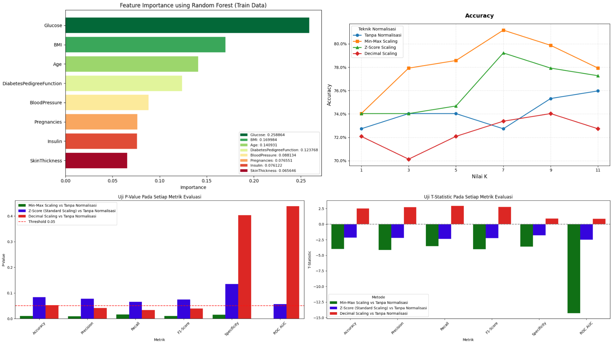
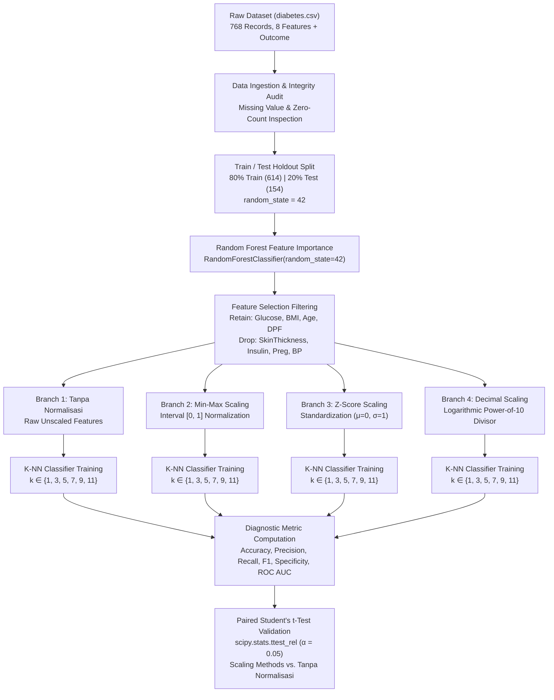

# Diabetes Classification Using KNN with Data Normalization

[](https://www.python.org/)
[](https://scikit-learn.org/)
[](https://scipy.org/)
[](https://pandas.pydata.org/)
[](https://numpy.org/)
[](https://matplotlib.org/)
[](https://seaborn.pydata.org/)
[](https://jupyter.org/)
[](./LICENSE)



**Diabetes Classification Using KNN with Data Normalization** is a supervised machine learning research and benchmarking project designed to evaluate how diverse feature scaling strategies influence the diagnostic accuracy and distance calculations of the **K-Nearest Neighbors (K-NN)** algorithm in detecting Diabetes Mellitus.

In distance-based machine learning classifiers such as K-NN, the decision boundary relies on pairwise distances (e.g., Euclidean distance) computed in multidimensional feature space. When physiological variables operate on drastically different numerical ranges—such as serum insulin reaching hundreds of $\mu\text{U/ml}$ versus diabetes pedigree function spanning decimals—unscaled features with larger absolute magnitudes disproportionately dominate distance metrics, overshadowing subtle yet clinically vital diagnostic indicators. This project investigates and resolves this challenge by systematically implementing Random Forest feature importance selection, applying three distinct normalization methodologies (**Min-Max Scaling**, **Z-Score Standard Scaling**, and **Decimal Scaling**) alongside an unnormalized baseline (**Tanpa Normalisasi**), evaluating K-NN performance across odd neighborhood counts ($k \in \{1, 3, 5, 7, 9, 11\}$), and conducting paired two-tailed Student's t-tests to establish statistical significance.

---

## Objectives & Use Cases

- **Automated Diabetes Mellitus Screening**: Classify diagnostic patient records into positive (`Outcome = 1`) or negative (`Outcome = 0`) diabetes cases based on clinical biometric predictors.
- **Distance Metric Sensitivity Analysis**: Quantify how magnitude imbalances among physiological metrics distort Euclidean proximity calculations in non-parametric instance-based classifiers.
- **Tree-Based Feature Importance Filtering**: Employ a Random Forest classifier to rank Gini impurity reductions across biometric variables, isolating the top four discriminative features (`Glucose`, `BMI`, `Age`, `DiabetesPedigreeFunction`) and eliminating redundant noise.
- **Comparative Normalization Benchmarking**: Systematically benchmark three normalization paradigms—bounded range scaling (Min-Max: $[0, 1]$), standard variance scaling (Z-Score: $\mu = 0, \sigma = 1$), and power-of-ten scaling (Decimal Scaling: $[-1, 1]$)—against unscaled raw baseline data.
- **Statistical Significance Validation**: Conduct two-tailed paired Student's t-tests (`scipy.stats.ttest_rel`) across all tested hyperparameter neighbors ($k \in \{1, 3, 5, 7, 9, 11\}$) at an $\alpha = 0.05$ decision boundary to verify whether observed performance gains are statistically significant or attributable to random variation.
- **Multi-Metric Clinical Diagnostics**: Measure classification quality across six metrics: Accuracy, Precision, Recall (Sensitivity), Specificity, F1-Score, and Receiver Operating Characteristic Area Under Curve (ROC AUC).

---

## Features

- **End-to-End Tabular Pipeline**:
  - Ingestion, validation, and missing-value profiling of 768 patient records from the Pima Indians Diabetes Database.
  - Reproducible 80/20 train-test partition (`test_size=0.2, random_state=42`) with full data persistence.
- **Random Forest Feature Importance Selection**:
  - Fits a 100-tree `RandomForestClassifier(random_state=42)` on training data to compute Mean Decrease in Impurity (MDI).
  - Automatically isolates the four highest-ranking predictive features (`Glucose`: 25.89%, `BMI`: 17.00%, `Age`: 14.09%, `DiabetesPedigreeFunction`: 12.38%) while pruning lower-contributing variables (`BloodPressure`, `Pregnancies`, `Insulin`, `SkinThickness`).
- **Four Normalization & Scaling Frameworks**:
  - **Tanpa Normalisasi**: Evaluates raw, unscaled features as the empirical benchmark control group.
  - **Min-Max Scaling**: Rescales selected features into the closed interval $[0, 1]$ via scikit-learn's `MinMaxScaler`, strictly fit on training data and applied to testing data.
  - **Z-Score (Standard Scaling)**: Transforms feature distributions to zero mean and unit variance ($\mu = 0, \sigma = 1$) via `StandardScaler`.
  - **Decimal Scaling**: Custom vectorized logarithmic normalizer computing $x' = \frac{x}{10^c}$ where $c = \lceil \log_{10}(\max(|x|)) \rceil$.
- **Systematic Neighborhood Exploration ($k$-Tuning)**:
  - Trains independent `KNeighborsClassifier` models across odd neighborhood values $k \in \{1, 3, 5, 7, 9, 11\}$ to prevent majority-vote ties.
- **Comprehensive Diagnostic Evaluation**:
  - Computes confusion matrices, macro-averaged Precision, Recall/Sensitivity, Specificity, F1-Score, and ROC AUC for each $(k, \text{method})$ permutation.
- **Rigorous Hypothesis Testing**:
  - Computes paired Student's t-statistics and exact $p$-values across all $k$-values comparing each scaling method to unnormalized data.
- **Publication-Ready Visualizations**:
  - Feature importance horizontal bar charts with divergent colormaps.
  - Six-metric performance trajectories across neighborhood values ($k$).
  - T-Statistic and P-Value comparative bar plots with threshold reference markers ($\alpha = 0.05$).

---

## Preview & Demo


*Figure 1: Comparative trajectories of Accuracy, Precision, Recall, F1-Score, Specificity, and ROC AUC across neighborhood values $k \in \{1, 3, 5, 7, 9, 11\}$ for Tanpa Normalisasi, Min-Max Scaling, Z-Score Scaling, and Decimal Scaling.*

---


*Figure 2: Feature importance scores derived from Random Forest on the training split, establishing Glucose (0.2589), BMI (0.1700), Age (0.1409), and DiabetesPedigreeFunction (0.1238) as the primary predictive attributes.*

---


*Figure 3: P-value evaluation across diagnostic metrics comparing each scaling technique against unnormalized baseline data with the critical $\alpha = 0.05$ significance threshold.*

---


*Figure 4: Paired t-statistic values across evaluation metrics. Negative values indicate that the normalized method outperformed the unnormalized baseline, whereas positive values indicate degradation.*

---

## Model Overview & Architecture

### Analytical Pipeline Architecture

The experimental workflow executes a structured pipeline comprising preprocessing, feature selection, data scaling, K-NN classification, and paired statistical hypothesis testing:



### Mathematical Foundations

#### 1. Euclidean Distance & Magnitude Sensitivity in K-NN

Given a query instance $\mathbf{x} = (x_1, x_2, \dots, x_p)$ and a training instance $\mathbf{z} = (z_1, z_2, \dots, z_p)$ in $p$-dimensional space, the standard Euclidean distance is defined as:

$$d(\mathbf{x}, \mathbf{z}) = \sqrt{\sum_{j=1}^p (x_j - z_j)^2}$$

When physiological attributes possess disparate variance and ranges (e.g., serum glucose $\in [0, 199]$ vs. diabetes pedigree function $\in [0.078, 2.42]$), the squared term $(x_{\text{Glucose}} - z_{\text{Glucose}})^2$ dominates the summation:

$$(x_{\text{Glucose}} - z_{\text{Glucose}})^2 \gg (x_{\text{DPF}} - z_{\text{DPF}})^2$$

This causes the classifier to assign nearest neighbors almost entirely based on glucose levels, effectively ignoring smaller-magnitude continuous biomarkers.

#### 2. Min-Max Normalization

Min-Max Scaling linearly maps each feature into the bounded interval $[0, 1]$:

$$x' = \frac{x - x_{\min}}{x_{\max} - x_{\min}}$$

Where $x_{\min}$ and $x_{\max}$ denote the empirical minimum and maximum values of the feature computed on the training partition. This transformation equalizes the maximum potential contribution of all features to the Euclidean distance without altering relative distances within each variable.

#### 3. Z-Score Standardization (Standard Scaling)

Z-Score normalization transforms feature distributions to have a sample mean of zero ($\mu = 0$) and unit variance ($\sigma = 1$):

$$z = \frac{x - \mu}{\sigma}$$

Where:
- $\mu = \frac{1}{N} \sum_{i=1}^N x_i$ is the empirical mean.
- $\sigma = \sqrt{\frac{1}{N} \sum_{i=1}^N (x_i - \mu)^2}$ is the standard deviation.

This technique is effective when features exhibit approximately normal distributions and preserves the presence of outliers.

#### 4. Decimal Scaling

Decimal scaling normalizes features into the range $[-1, 1]$ by dividing values by a power of 10 determined by the maximum absolute value observed in the feature:

$$x' = \frac{x}{10^c}, \quad \text{where } c = \left\lceil \log_{10}(\max(|x|)) \right\rceil$$

Unlike Min-Max Scaling, Decimal Scaling preserves the origin ($0$ remains $0$) and relative magnitude, but features with maximum values of 199 and 80 are divided by $10^3 = 1000$ and $10^2 = 100$ respectively, leading to differing compressed scales ($[0, 0.199]$ vs $[0, 0.8]$).

#### 5. Random Forest Mean Decrease in Impurity (MDI)

Feature importance is quantified by calculating the total reduction in Gini impurity brought about by splits on feature $j$, averaged across all $M$ decision trees in the ensemble:

$$\text{Importance}(j) = \frac{1}{M} \sum_{m=1}^M \sum_{t \in T_m : v(t) = j} p(t) \Delta I(t)$$

Where:
- $p(t) = \frac{N_t}{N}$ represents the proportion of samples reaching node $t$.
- $\Delta I(t) = I(t) - \frac{N_{t_L}}{N_t} I(t_L) - \frac{N_{t_R}}{N_t} I(t_R)$ denotes the impurity decrease at node $t$.
- $I(t) = 1 - \sum_{k=0}^1 p_{t, k}^2$ represents the Gini impurity.

#### 6. Paired Student's t-Test for Statistical Hypothesis Testing

To assess whether a normalization technique yields a statistically significant difference compared to unnormalized baseline data across the paired neighborhood evaluations ($k \in \{1, 3, 5, 7, 9, 11\}$, $n = 6$):

$$d_i = y_{\text{baseline}, i} - y_{\text{normalized}, i}$$

$$\bar{d} = \frac{1}{n} \sum_{i=1}^n d_i, \quad s_d = \sqrt{\frac{1}{n-1} \sum_{i=1}^n (d_i - \bar{d})^2}$$

$$t = \frac{\bar{d}}{s_d / \sqrt{n}}, \quad \text{degrees of freedom } \nu = n - 1 = 5$$

Under the null hypothesis $H_0: \mu_d = 0$ (no performance difference), the two-tailed $p$-value is determined. If $p < 0.05$, $H_0$ is rejected in favor of $H_1$, establishing statistically significant performance disparity.

---

## Tech Stack

| Category | Technology | Purpose in Project |
| :--- | :--- | :--- |
| **Language** | Python 3.10+ | Core runtime environment for all data manipulation, modeling, and statistical testing |
| **Machine Learning** | scikit-learn | `KNeighborsClassifier`, `RandomForestClassifier`, `MinMaxScaler`, `StandardScaler`, `train_test_split` |
| **Statistical Computing** | SciPy | Paired Student's t-test computation (`scipy.stats.ttest_rel`) for hypothesis testing |
| **Data Manipulation** | Pandas | Dataframe manipulation, CSV reading/writing, descriptive statistics, and dataset restructuring |
| **Scientific Computing** | NumPy | Matrix operations, vectorized calculations, array transformations, and logarithmic ceiling functions |
| **Data Visualization** | Matplotlib & Seaborn | Multi-panel metric trajectory plots, feature importance bar charts, and statistical test plots |
| **Interactive Computing** | Jupyter Notebook | Interactive workflow execution, exploratory analysis, and visual experiment outputs |

---

## Dataset

The experiment utilizes the benchmark **Pima Indians Diabetes Database** (`diabetes.csv`), sourced from the National Institute of Diabetes and Digestive and Kidney Diseases (NIDDK).

### Dataset Attributes & Summary Statistics

| Feature Name | Clinical Description | Data Type | Range in Dataset |
| :--- | :--- | :---: | :---: |
| **Pregnancies** | Number of times pregnant | Integer | $0 - 17$ |
| **Glucose** | Plasma glucose concentration at 2 hours in an oral glucose tolerance test | Integer | $0 - 199\ \text{mg/dL}$ |
| **BloodPressure** | Diastolic blood pressure | Integer | $0 - 122\ \text{mm Hg}$ |
| **SkinThickness** | Triceps skin fold thickness | Integer | $0 - 99\ \text{mm}$ |
| **Insulin** | 2-Hour serum insulin | Integer | $0 - 846\ \mu\text{U/mL}$ |
| **BMI** | Body mass index ($\text{weight in kg} / (\text{height in m})^2$) | Float | $0.0 - 67.1$ |
| **DiabetesPedigreeFunction** | Diabetes pedigree genetic scoring function | Float | $0.078 - 2.420$ |
| **Age** | Age in years | Integer | $21 - 81$ |
| **Outcome** *(Target)* | Diabetes diagnosis ($0 = \text{Non-diabetic}, 1 = \text{Diabetic}$) | Binary | $\{0, 1\}$ |

- **Total Records**: 768 patient samples.
- **Class Distribution**:
  - `0` (Negative / Non-diabetic): 500 samples (65.10%)
  - `1` (Positive / Diabetic): 268 samples (34.90%)
- **Data Partition**:
  - **Training Set** (`diabetes_train.csv`): 614 samples (80.0%)
  - **Testing Set** (`diabetes_test.csv`): 154 samples (20.0%)

### Feature Selection Summary

Following Random Forest feature importance scoring on the training split, the dataset was reduced to the top four predictors:

| Selected Features (Retained) | Discarded Features (Pruned) | Selection Criterion |
| :--- | :--- | :--- |
| `Glucose` (25.89%)<br>`BMI` (17.00%)<br>`Age` (14.09%)<br>`DiabetesPedigreeFunction` (12.38%) | `BloodPressure` (8.81%)<br>`Pregnancies` (7.66%)<br>`Insulin` (7.61%)<br>`SkinThickness` (6.56%) | Mean Decrease in Impurity (MDI) via `RandomForestClassifier(random_state=42)` |

---

## Prerequisites

- **Python Version**: Python 3.10 or higher.
- **Compute Architecture**: Standard multi-core x86_64 or ARM64 CPU. No dedicated GPU acceleration is required.
- **Memory Requirements**: Minimum 4 GB RAM.
- **Disk Space**: Approximately 500 MB free space for virtual environment, dependencies, and Jupyter cache.

---

## Installation & Setup

### 1. Clone the Repository

```bash
git clone https://github.com/weztcy/Diabetes-Classification-Using-KNN-with-Data-Normalization.git
cd "Diabetes-Classification-Using-KNN-with-Data-Normalization"
```

### 2. Configure Virtual Environment

**Windows (PowerShell):**
```powershell
python -m venv venv
.\venv\Scripts\Activate.ps1
```

**Windows (Command Prompt):**
```cmd
python -m venv venv
.\venv\Scripts\activate.bat
```

**Linux / macOS:**
```bash
python3 -m venv venv
source venv/bin/activate
```

### 3. Install Dependencies

Install the verified libraries required to run all experiment notebooks:

```bash
pip install numpy pandas scipy scikit-learn matplotlib seaborn jupyter
```

---

## Usage / Inference

### Executing the Experiment Notebooks

Launch Jupyter Notebook from the project root directory:

```bash
jupyter notebook
```

Execute the notebooks according to the experimental sequence:

1. **Unnormalized Baseline Model**:
   - Open and run [`Tanpa Normalisasi/Eksperimen 2 - Tanpa Normalisasi.ipynb`](./Tanpa%20Normalisasi/Eksperimen%202%20-%20Tanpa%20Normalisasi.ipynb).
   - Generates baseline K-NN metrics and exports training/testing partitions.
2. **Min-Max Scaling Experiment**:
   - Open and run [`Min-Max Scaling/Eksperimen 2 - Min-Max Scaling.ipynb`](./Min-Max%20Scaling/Eksperimen%202%20-%20Min-Max%20Scaling.ipynb).
   - Applies $[0, 1]$ feature scaling and measures evaluation metrics across $k \in \{1, 3, 5, 7, 9, 11\}$.
3. **Z-Score Scaling Experiment**:
   - Open and run [`Z-Score (Standard Scaling)/Eksperimen 2 - Z-Score (Standard Scaling).ipynb`](./Z-Score%20%28Standard%20Scaling%29/Eksperimen%202%20-%20Z-Score%20%28Standard%20Scaling%29.ipynb).
   - Standardizes selected features to zero mean and unit variance.
4. **Decimal Scaling Experiment**:
   - Open and run [`Decimal Scaling/Eksperimen 2 - Decimal Scaling.ipynb`](./Decimal%20Scaling/Eksperimen%202%20-%20Decimal%20Scaling.ipynb).
   - Normalizes selected features via logarithmic base-10 divisors.
5. **Comparative Metrics Visualization**:
   - Open and run [`Visualisasi/Metrik_Evaluasi.ipynb`](./Visualisasi/Metrik_Evaluasi.ipynb).
   - Compiles metrics across all four pipelines and plots comparative trajectory graphs.
6. **Paired Statistical Significance Analysis**:
   - Open and run [`Visualisasi/Signifikansi Semua Nilai K.ipynb`](./Visualisasi/Signifikansi%20Semua%20Nilai%20K.ipynb).
   - Computes paired t-statistics and $p$-values across all diagnostic metrics.
7. **Statistical Testing Charts**:
   - Open and run [`Visualisasi/Visualisasi Uji Statistik.ipynb`](./Visualisasi/Visualisasi%20Uji%20Statistik.ipynb).
   - Generates comparative t-statistic and $p$-value bar plots.

---

### Programmatic Python Inference

You can also load the preprocessed datasets and execute standalone inference using the optimal model configuration (**Min-Max Scaling with $k = 7$**):

```python
import pandas as pd
from sklearn.model_selection import train_test_split
from sklearn.preprocessing import MinMaxScaler
from sklearn.neighbors import KNeighborsClassifier

# 1. Load dataset
df = pd.read_csv("diabetes.csv")

# 2. Select the top 4 features identified by Random Forest
selected_features = ["Glucose", "BMI", "Age", "DiabetesPedigreeFunction"]
X = df[selected_features]
y = df["Outcome"]

# 3. Partition data
X_train, X_test, y_train, y_test = train_test_split(
    X, y, test_size=0.2, random_state=42
)

# 4. Fit MinMaxScaler on training data and transform splits
scaler = MinMaxScaler()
X_train_scaled = scaler.fit_transform(X_train)
X_test_scaled = scaler.transform(X_test)

# 5. Initialize and train optimal K-NN classifier (k=7)
knn = KNeighborsClassifier(n_neighbors=7)
knn.fit(X_train_scaled, y_train)

# 6. Predict on sample clinical observations
# Format: [Glucose (mg/dL), BMI, Age, DiabetesPedigreeFunction]
sample_patients = pd.DataFrame([
    [148.0, 33.6, 50, 0.627],  # Clinical profile A (High risk)
    [85.0, 26.6, 31, 0.351]    # Clinical profile B (Low risk)
], columns=selected_features)

sample_scaled = scaler.transform(sample_patients)
predictions = knn.predict(sample_scaled)
probabilities = knn.predict_proba(sample_scaled)

for i, (pred, prob) in enumerate(zip(predictions, probabilities)):
    status = "Diabetic (Positive)" if pred == 1 else "Non-Diabetic (Negative)"
    print(f"Patient {i+1}: {status} | Risk Probability: {prob[1]:.2%}")
```

---

## Training & Experimental Setup

### Experimental Configuration Parameters

- **Random Seed**: Fixed to `42` across dataset partitioning and Random Forest initialization for deterministic reproducibility.
- **Holdout Partition**: 80% Training (614 rows), 20% Testing (154 rows).
- **Distance Metric**: Euclidean metric ($L_2$-norm) with uniform sample weighting (`weights='uniform'`).
- **Tested Neighborhood Values ($k$)**: $k \in \{1, 3, 5, 7, 9, 11\}$.
- **Feature Selection Model**: `RandomForestClassifier(random_state=42)` fitted on full training features to compute Gini feature importance.
- **Scaling Implementations**:
  - `MinMaxScaler()` from `sklearn.preprocessing`.
  - `StandardScaler()` from `sklearn.preprocessing`.
  - Vectorized Decimal Scaling function: $f(X) = X / 10^{\lceil \log_{10}(\max(X)) \rceil}$.

---

## Evaluation & Results

### Comprehensive Performance Benchmark

The following table summarizes the measured performance of all four data normalization techniques across tested neighborhood counts ($k \in \{1, 3, 5, 7, 9, 11\}$) on the held-out test split (154 samples):

| Normalization Technique | $k$ Value | Accuracy | Precision | Recall | F1-Score | Specificity | ROC AUC |
| :--- | :---: | :---: | :---: | :---: | :---: | :---: | :---: |
| **Tanpa Normalisasi** *(Baseline)* | 1 | 72.73% | 70.30% | 70.30% | 70.30% | 78.79% | 70.30% |
| | 3 | 74.03% | 71.79% | 72.12% | 71.94% | 78.79% | 75.87% |
| | 5 | 74.03% | 71.88% | 72.53% | 72.15% | 77.78% | 77.19% |
| | 7 | 72.73% | 70.65% | 71.52% | 70.96% | 75.76% | 77.07% |
| | 9 | 75.32% | 73.18% | 73.54% | 73.34% | 79.80% | 77.51% |
| | 11 | 75.97% | 73.90% | 74.44% | 74.14% | 79.80% | 78.02% |
| **Min-Max Scaling** | 1 | 74.03% | 71.79% | 72.12% | 71.94% | 78.79% | 72.12% |
| | 3 | 77.92% | 75.96% | 76.36% | 76.15% | 81.82% | 78.44% |
| | 5 | 78.57% | 76.66% | 76.87% | 76.76% | 82.83% | 79.10% |
| | **7** | **81.17%** | **79.46%** | **79.70%** | **79.58%** | **84.85%** | **79.50%** |
| | 9 | 79.87% | 78.11% | 77.88% | 77.99% | 84.85% | 80.37% |
| | 11 | 77.92% | 75.99% | 75.56% | 75.76% | 83.84% | 80.50% |
| **Z-Score (Standard Scaling)** | 1 | 74.03% | 71.72% | 71.72% | 71.72% | 79.80% | 71.72% |
| | 3 | 74.03% | 71.88% | 72.53% | 72.15% | 77.78% | 75.53% |
| | 5 | 74.68% | 72.52% | 73.03% | 72.74% | 78.79% | 76.97% |
| | 7 | 79.22% | 77.37% | 77.37% | 77.37% | 83.84% | 79.69% |
| | 9 | 77.92% | 75.99% | 75.56% | 75.76% | 83.84% | 80.60% |
| | 11 | 77.27% | 75.29% | 75.86% | 75.54% | 80.81% | 81.29% |
| **Decimal Scaling** | 1 | 72.08% | 69.64% | 69.80% | 69.72% | 77.78% | 69.80% |
| | 3 | 70.13% | 68.13% | 69.09% | 68.40% | 72.73% | 73.91% |
| | 5 | 72.08% | 69.76% | 70.20% | 69.95% | 76.77% | 75.33% |
| | 7 | 73.38% | 71.14% | 71.62% | 71.35% | 77.78% | 77.28% |
| | 9 | 74.03% | 71.72% | 71.72% | 71.72% | 79.80% | 78.34% |
| | 11 | 72.73% | 70.24% | 69.90% | 70.06% | 79.80% | 78.74% |

---

### Statistical Hypothesis Testing (Paired Student's t-Test)

To rigorously verify whether normalization produces statistically significant alterations over unnormalized baseline data, two-tailed paired t-tests (`scipy.stats.ttest_rel`) were evaluated across all tested neighborhood configurations ($k \in \{1, 3, 5, 7, 9, 11\}$, $n = 6$, $\text{df} = 5$):

| Diagnostic Metric | Min-Max Scaling vs. Tanpa Normalisasi | Z-Score Scaling vs. Tanpa Normalisasi | Decimal Scaling vs. Tanpa Normalisasi |
| :--- | :---: | :---: | :---: |
| **Accuracy** | $t = -3.99754,\ p = \mathbf{0.01035}\ ^*$ | $t = -2.15584,\ p = 0.08363$ | $t = +2.52689,\ p = 0.05273$ |
| **Precision** | $t = -4.12930,\ p = \mathbf{0.00909}\ ^*$ | $t = -2.21749,\ p = 0.07737$ | $t = +2.73333,\ p = \mathbf{0.04112}\ ^\dagger$ |
| **Recall** | $t = -3.54493,\ p = \mathbf{0.01648}\ ^*$ | $t = -2.35725,\ p = 0.06497$ | $t = +2.92463,\ p = \mathbf{0.03284}\ ^\dagger$ |
| **F1-Score** | $t = -4.02148,\ p = \mathbf{0.01011}\ ^*$ | $t = -2.25157,\ p = 0.07413$ | $t = +2.77965,\ p = \mathbf{0.03892}\ ^\dagger$ |
| **Specificity** | $t = -3.60555,\ p = \mathbf{0.01545}\ ^*$ | $t = -1.78377,\ p = 0.13454$ | $t = +0.91287,\ p = 0.40318$ |
| **ROC AUC** | $t = -14.30525,\ p = \mathbf{0.00003}\ ^*$ | $t = -2.47726,\ p = 0.05603$ | $t = +0.84161,\ p = 0.43839$ |

$^*$ *Statistically significant improvement over baseline ($p < 0.05$, negative $t$-statistic).*  
$^\dagger$ *Statistically significant degradation compared to baseline ($p < 0.05$, positive $t$-statistic).*

---

### Core Empirical Findings

1. **Superiority of Min-Max Scaling**: Min-Max Scaling achieved the highest overall diagnostic performance across all metrics, peaking at $k = 7$ with **81.17% Accuracy**, **79.46% Precision**, **79.70% Recall**, **79.58% F1-Score**, **84.85% Specificity**, and **79.50% ROC AUC**. The paired t-test confirmed that Min-Max Scaling is **statistically significantly superior** to unnormalized data across all six diagnostic metrics ($p < 0.05$, and $p = 0.00003$ for ROC AUC).
2. **Behavior of Z-Score Standardization**: Z-Score scaling consistently outperformed raw features in absolute terms (reaching 79.22% accuracy at $k = 7$), but the difference did not achieve statistical significance at the $\alpha = 0.05$ threshold ($p = 0.056$ to $0.135$). This is attributed to variance compression differences across non-normally distributed physiological biomarkers.
3. **Ineffectiveness of Decimal Scaling**: Decimal scaling failed to improve upon unnormalized features (peaking at only 74.03% accuracy at $k = 9$). Furthermore, positive t-statistics indicated that Decimal Scaling **statistically degraded** Precision ($p = 0.041$), Recall ($p = 0.033$), and F1-Score ($p = 0.039$) compared to using raw unnormalized features. This occurs because dividing by powers of 10 creates uneven compression bounds across variables without normalizing them to a common scale.
4. **Optimal Neighborhood Parameter ($k$)**: Across all methods, $k = 7$ proved to be the most balanced neighborhood parameter, dampening local point noise while maintaining sharp decision boundaries.

---

## Reproducibility

To ensure identical experimental results upon re-execution:

- **Partition Seed**: The holdout split was executed using `train_test_split(..., test_size=0.2, random_state=42)`.
- **Feature Selection Seed**: Random Forest importance was computed with `RandomForestClassifier(random_state=42)`.
- **Preprocessed Artifacts**: All intermediate training and testing splits, selected feature datasets, and scaled feature variants are saved as versioned CSV files inside each corresponding experiment folder:
  - `diabetes_train.csv` / `diabetes_test.csv` (Raw 80/20 split)
  - `diabetes_train_selected.csv` / `diabetes_test_selected.csv` (Top 4 features)
  - `diabetes_train_scaled.csv` / `diabetes_test_scaled.csv` (Scaled feature representations)

---

## Limitations & Considerations

- **Dataset Demographics & Generalizability**: The Pima Indians Diabetes Database is restricted to female patients of Pima Indian heritage aged 21 years and older. Performance characteristics may vary across broader multi-ethnic cohorts or clinical populations with differing demographic baselines.
- **Biometric Zero-Value Artifacts**: In the raw dataset, biologically implausible zero values exist for physiological parameters such as blood pressure, glucose, skin thickness, and insulin. In this study, lower-ranked features with substantial zero frequencies (`SkinThickness`, `Insulin`) were pruned during Random Forest feature selection, while remaining features were modeled in their documented tabular format.
- **Computational Complexity of K-NN**: As an instance-based lazy learner, K-NN computes distance to all training instances at query time ($O(N \cdot d)$ complexity). While instantaneous on 768 records, high-throughput hospital production deployments would benefit from indexing structures (e.g., KD-Tree, BallTree) or approximate nearest neighbor algorithms.

---

## License

Please see the [LICENSE](./LICENSE) file for the terms and conditions governing the use, modification, and distribution of this project.

---

## Author & Contact

**Yohanes Dimas Pratama**

- GitHub: [github.com/weztcy](https://github.com/weztcy)
- Portfolio: [dimaspratama.vercel.app](https://dimaspratama.vercel.app)
- LinkedIn: [linkedin.com/in/yohanes-dimas](https://www.linkedin.com/in/yohanes-dimas)
